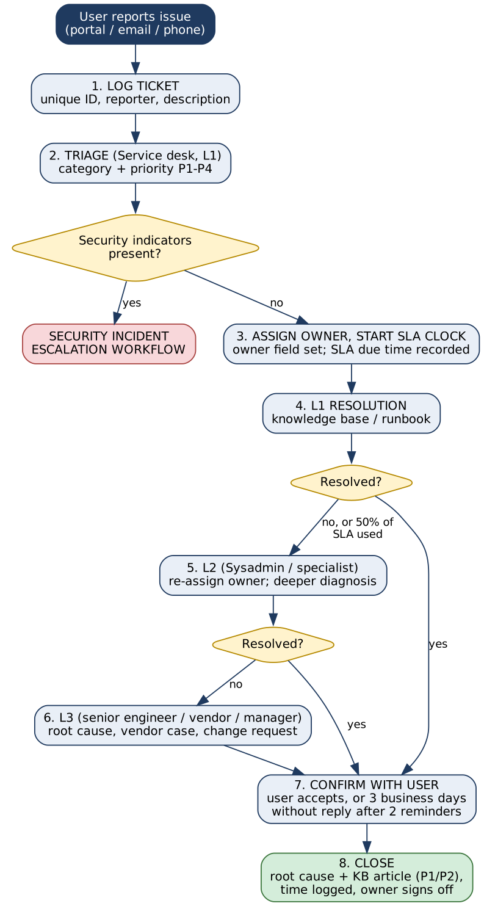
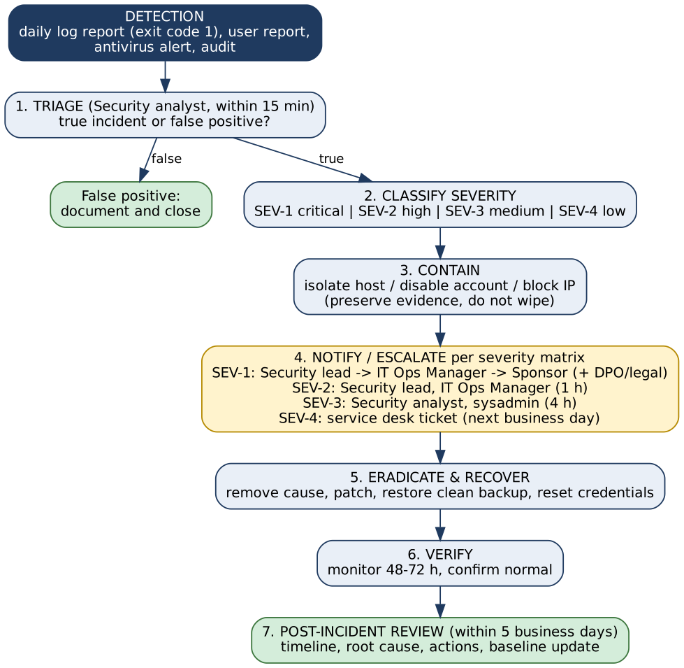

# Troubleshooting & Escalation Matrix

*Version 1.1 (revised after independent review). Workflow diagrams are in `diagrams/` and embedded below.*

## 1. IT Support Ticket Process Map

### Required ticket fields
| Field | Purpose |
|---|---|
| Ticket ID | Unique reference used in every message |
| Reporter, contact | Who to confirm with |
| Category | Hardware / Software / Access / Network / Security |
| Priority (P1-P4) | Set at triage; drives SLA |
| **Owner (assignee)** | **Exactly one named person who owns the SLA clock; changes at each escalation level** |
| **SLA due time** | **Calculated when the owner is assigned (step 3)** |
| Escalation level, history | L1 / L2 / L3 and who handed over to whom |
| Resolution, root cause | Required at closure (root cause and KB link for P1/P2) |

### Closure criteria
A ticket is closed only when all of these are true:
1. The reporter confirmed the fix, **or** there was no reply 3 business days after the confirmation request and two reminders (closure note says so).
2. Resolution is described; root cause and a knowledge-base article exist for P1/P2.
3. Time spent is logged and the owner has signed off.
4. Any follow-up work is a separate ticket linked to this one.

### Priority & SLA table
| Priority | Definition | Example | Response | Resolution target |
|---|---|---|---|---|
| P1 Critical | Service down or security breach, many users affected | Server outage, ransomware | 15 min | 4 hours |
| P2 High | Major function degraded or one VIP/critical user blocked | VPN down for a team | 30 min | 8 hours |
| P3 Medium | Single user impacted, workaround exists | Printer, software error | 4 hours | 3 business days |
| P4 Low | Request or minor issue | New software request | 1 business day | 5 business days |

### Troubleshooting Quick Matrix
| Symptom | First checks (L1) | Escalate to L2 when |
|---|---|---|
| Cannot log in | Account locked/expired? Caps Lock, MFA device, password reset | Repeated lockouts, account suspected compromised -> Security |
| Slow computer | Disk space, running processes (`top` / Task Manager), pending updates, reboot | Persistent after cleanup, signs of malware |
| No network | Cable/Wi-Fi, IP (`ip a` / `ipconfig`), ping gateway & DNS | Multiple users affected, DHCP/DNS/switch fault |
| Linux service failing | `systemctl status <svc>`, `journalctl -u <svc> -n 50`, disk/memory | Config or dependency fault, repeated crash |
| Windows app crash | Event Viewer (Application log), update/reinstall, check disk | Reproducible across users, vendor bug |
| Disk almost full | `df -h` / `du -sh *`, clear temp/log rotation | Growth unexplained -> possible log flood/incident |
| Suspicious email | Do not open; report to security | Always forward to Security |

## 2. Escalation Rules
- **Time-based:** escalate to the next level if no progress at 50% of the resolution target; the new owner is recorded in the ticket.
- **Impact-based:** more than 5 users or any critical system affected -> immediate L2 and notify the manager.
- **Risk-based:** any security indicator -> immediate Security escalation regardless of priority.
- **Handover quality:** each escalation includes ticket ID, symptoms, steps already taken, logs/screenshots and business impact.

## 3. Security Incident Escalation Workflow

### Severity & Notification Matrix
| Severity | Examples | Escalate to | Time | Actions |
|---|---|---|---|---|
| SEV-1 | Ransomware, confirmed data breach, domain admin compromise | Security lead -> IT Ops Manager -> Sponsor / management (and legal/DPO where personal data is involved) | Immediate (within 15 min) | Isolate, incident bridge call, preserve evidence |
| SEV-2 | Malware on one host, successful brute-force login, privilege escalation, unapproved account with admin rights | Security lead, IT Ops Manager | Within 1 hour | Disable account, isolate host, reset credentials |
| SEV-3 | Brute-force burst: **5 or more failed attempts from one source IP within 10 minutes** (the analyzer's default `--threshold 5 --window 10`), sudo failures, new account, policy violation, suspicious email clicked | Security analyst, sysadmin | Within 4 hours | Block IP, user coaching, monitor |
| SEV-4 | Fewer than 5 failed attempts in the window, root login attempts, dormant account, minor policy deviation | Service desk ticket | Next business day | Log and trend |

The analyzer assigns these same severities; if the thresholds are changed in the script they must be changed here too (change request to the Security lead).

### RACI for Incidents
| Activity | Service Desk | Sysadmin | Security | IT Manager |
|---|---|---|---|---|
| Detect & log | R | C | C | I |
| Triage & classify | C | C | R/A | I |
| Contain | I | R | A | I |
| Communicate to management | I | I | R | A |
| Recover | I | R | A | I |
| Post-incident review | C | C | R | A |

*R = Responsible, A = Accountable, C = Consulted, I = Informed.*

### Data-breach note
If personal data is affected, involve the data-protection officer immediately; under GDPR the supervisory authority must be notified within 72 hours of becoming aware of a breach where required.
